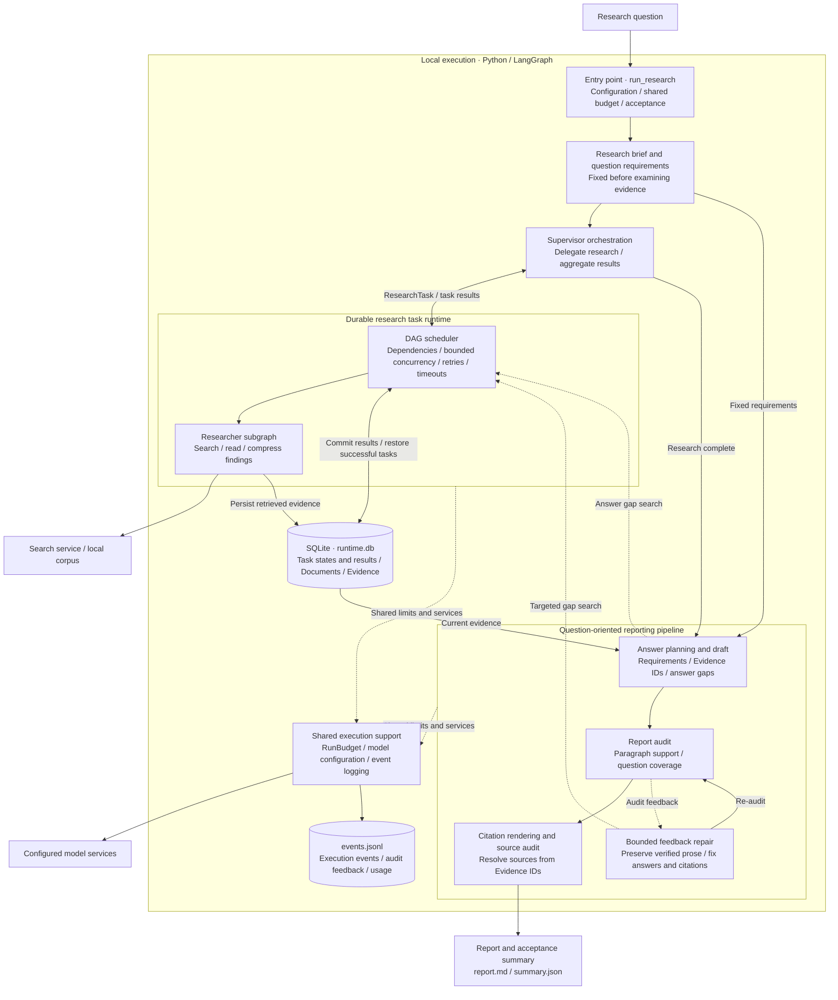

# Reliable Deep Research

English | [简体中文](README.zh-CN.md)

**Make research tasks recoverable, cover the question, and repair evidence and citation gaps within a bounded budget.**

An engineering extension of [LangChain Open Deep Research](https://github.com/langchain-ai/open_deep_research), built with Python, LangGraph, asyncio, Pydantic and SQLite. The upstream agent supplies research orchestration and provider integrations; this project adds durable task execution and an **Evidence → Question Coverage → Verified Report** pipeline.

**Reliable Deep Research: a recoverable deep research system with traceable evidence.** Its mainline combines durable research tasks, question-oriented reporting and bounded semantic repair. The earlier Claim-first approach is retained only as an evaluation control. The approaches are described in the [evaluation protocol](docs/evaluation.md#experiment-identifiers).

## Problem and approach

Long research runs can lose completed work after a crash. Reports can also cite real sources that do not support their statements. These require different controls:

- **Durable tasks:** a bounded DAG scheduler persists completed task results, retries failed work and invalidates stale evidence from unfinished attempts.
- **Question-oriented reporting:** derive requirements before reading evidence, identify missing answers, audit report paragraphs against stored passages and render citations from Evidence IDs.
- **Bounded repair:** preserve verified paragraphs and repair answers and citations from current audit feedback, with at most two repair rounds and two targeted gap tasks within shared budgets.
- **Bounded execution:** shared call, token, task-attempt and time budgets constrain concurrent researchers. Reports retain acceptance checks and inspectable failure records.

## Architecture

The supported entry point runs a local LangGraph workflow: the supervisor delegates research tasks, the durable runtime executes researcher subgraphs, and the reporting pipeline plans, audits and repairs answers against fixed question requirements.



Groups represent modules within one process. Solid arrows show primary calls or data relationships; dotted arrows show feedback or shared support relationships. Orchestration, research and reporting share model configuration, event logging and in-memory budgets, with at most two repair rounds and two total targeted gap tasks across planning and repair. Each stage logs execution and audit events; the runner saves the acceptance summary.

Recovery applies to research tasks. Whole-session LangGraph recovery and exactly-once external API calls are outside its guarantee. Evidence lineage establishes where a statement came from; semantic support remains a fallible model judgment. [Architecture and decisions](docs/project_overview.md).

## Evaluation

30 evaluation questions, each run independently twice (60 evaluation slots), share 24 fixed reference sources. Repository Baseline and the earlier Claim-first approach retain their original attempts.

**Repository Baseline** follows the upstream Open Deep Research workflow and retains this repository's experimental adaptations for retrieval, model access and budgets.

| Metric | Repository Baseline | Claim-first (earlier approach) | Reliable Deep Research |
| --- | ---: | ---: | ---: |
| Accepted | 52/60 | 51/60 | **59/60** |
| Degraded / needs review | 0 | 0 | **0** |
| Failed or budget-exhausted | 8 | 9 | **1** |
| Reference-point coverage, all slots | 80.4% | 64.9% | **88.7%** |
| Coverage within accepted reports | 93.1% | 75.7% | **90.3%** |
| Sampled citation statements judged supported | 60.9% | 96.1% | **93.6%** |
| Mean seconds | 404.9 | 667.6 | **319.3** |
| Mean model calls | 9.52 | 19.42 | **15.25** |

Coverage numerators count accepted reports; failures contribute zero. Citation support samples at most five statements per report. The references are assistant-authored and judging uses the same gateway model alias as generation; independent human review is pending. The table shows the observed development outcome; sample selection and configuration changes limit causal interpretation. [Protocol, provenance and limitations](docs/evaluation.md) · [All 180 comparison slots](benchmarks/results/release_comparison.json).

Separate synthetic recovery experiments recovered transient errors/timeouts in 30/30 trials each. In 20/20 process restarts after a task committed, Reliable reused that result without executing the task again; unfinished-attempt tests removed stale Evidence/Claims. [Recovery details](docs/recovery.md).

## Try it

Install [uv](https://docs.astral.sh/uv/getting-started/installation/), then run from the repository root. These commands work in PowerShell and Bash:

```bash
uv sync --frozen --python 3.11 --extra dev
uv run --frozen python -m experiments.reliability.reliability_demo
uv run --frozen --extra dev python -m pytest -q
```

The demo requires **no API keys**. It injects a task failure, retries, then replays dependent tasks while reusing completed search work. Inspect `artifacts/reliability_demo/result.json`, `events.jsonl` and `runtime.db`. It demonstrates runtime behavior using synthetic tasks.

For a live research report, copy `.env.example` to `.env`, set `OPENAI_API_KEY` and `TAVILY_API_KEY`, then run:

```bash
uv run --frozen python -m experiments.runners.run_research --question "What are the failure and recovery trade-offs of durable agent workflows? Cite primary sources."
```

This makes paid model/search calls. The supported entry point uses defaults of 40 model calls, 4 searches, 6 task attempts and 1,200 seconds. Each case gets its own database. The output directory contains the report, acceptance summary and event trace; a nonzero exit means the run did not pass. [Setup, custom endpoints, local retrieval and output](docs/running.md).

## Code map

| Path | Responsibility |
| --- | --- |
| [task_runtime.py](src/open_deep_research/task_runtime.py), [runtime_store.py](src/open_deep_research/runtime_store.py) | DAG scheduling, transactional task results, retry/replay invalidation |
| [coverage_reporting.py](src/open_deep_research/coverage_reporting.py), [report_planning.py](src/open_deep_research/report_planning.py) | Question requirements, semantic audit/repair, evidence-ID citation rendering |
| [run_budget.py](src/open_deep_research/run_budget.py), [observability.py](src/open_deep_research/observability.py) | Shared resource limits and event logs |
| [run_research.py](experiments/runners/run_research.py) | Supported entry point; delegates to the existing run and acceptance engine |
| `tests/`, [benchmarks/](benchmarks/README.md) | Offline regression checks, questions, source metadata and numeric evidence |

[Running](docs/running.md) · [Architecture](docs/project_overview.md) · [Evaluation](docs/evaluation.md) · [Recovery](docs/recovery.md) · [Publishing](PUBLISHING.md). Raw corpora, generated reports, databases and caches are excluded.
