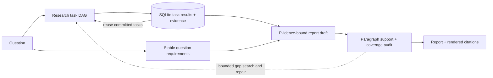

# Reliable Deep Research

English | [简体中文](README.zh-CN.md)

**Recover research tasks. Answer the question with traceable evidence. Repair gaps within a bounded budget.**

An engineering extension of [LangChain Open Deep Research](https://github.com/langchain-ai/open_deep_research), built with Python, LangGraph, asyncio, Pydantic and SQLite. The upstream agent supplies research orchestration and provider integrations; this project adds durable task execution and an **Evidence → Question Coverage → Verified Report** pipeline.

**Reliable Deep Research** combines durable research tasks, question-oriented reporting and bounded semantic repair. The earlier Claim-first approach is retained only as an evaluation control. Experiment settings and results are documented in the [evaluation guide](docs/evaluation.md).

## Problem and approach

Long research runs can lose completed work after a crash. Reports can also cite real sources that do not support their statements. These require different controls:

- **Durable tasks:** a bounded DAG scheduler persists completed task results, retries failed work and invalidates stale evidence from unfinished attempts.
- **Question-oriented reporting:** derive requirements before reading evidence, identify missing answers, audit report paragraphs against stored passages and render citations from Evidence IDs.
- **Bounded repair:** preserve verified paragraphs, repair from current audit feedback, recheck citation edits, and allow at most two repair rounds and two targeted gap tasks within shared budgets.
- **Bounded execution:** shared call, token, task-attempt and time budgets constrain concurrent researchers. Reports retain acceptance checks and inspectable failure records.



Recovery applies to research tasks. Whole-session LangGraph recovery and exactly-once external API calls are outside its guarantee. Evidence lineage establishes where a statement came from; semantic support remains a fallible model judgment. [Architecture and decisions](docs/project_overview.md).

## Evaluation

**30 questions, two slots per question, 24 fixed documents.** Repository Baseline and Claim-first retain all historical attempts. The released project is represented by a **replacement view: 47 original accepted runs + all 13 corresponding Reliable Deep Research reruns**, including one remaining failure.

**Repository Baseline** uses the upstream Open Deep Research workflow within this repository, with our reliability runtime, evidence review and repair features disabled. It retains repository-specific experimental adaptations for retrieval, model access and budgets; these results are not from an unmodified official upstream release.

| Metric | Repository Baseline | Claim-first (earlier approach) | Reliable Deep Research¹ |
| --- | ---: | ---: | ---: |
| Accepted / slots | 52/60 | 51/60 | **59/60** |
| Degraded / needs review | 0 | 0 | **0** |
| Failed or budget-exhausted | 8 | 9 | **1** |
| Reference-point coverage, all slots | 80.4% | 64.9% | **88.7%** |
| Coverage within accepted reports | 93.1% | 75.7% | **90.3%** |
| Sampled citation statements judged supported | 60.9% | 96.1% | **93.6%** |
| Mean seconds, including failures | 404.9 | 667.6 | **319.3** |
| Mean model calls, including failures | 9.52 | 19.42 | **15.25** |

¹ A post-hoc development summary using two coverage revisions, not a fresh 60-attempt evaluation entirely on the released configuration. The coverage rounds consumed 73 generation attempts to fill these 60 slots. All 13 original unsuccessful slots are replaced, including the rerun that failed; no best-of selection is used. Aggregate time/calls describe the selected slots and exclude the cost of the 13 displaced original attempts.

Coverage numerators count accepted reports; failures contribute zero. Citation support samples at most five statements per report and is conditional on accepted reports with extractable citations. The references are assistant-authored and judging uses the same gateway model alias as generation; independent human review is pending. The replacement view shows the observed development outcome, with selection and configuration changes limiting causal interpretation. [Protocol, provenance and limitations](docs/evaluation.md) · [All 180 comparison slots](benchmarks/results/release_comparison.json).

Separate synthetic recovery experiments recovered transient errors/timeouts in 30/30 trials each. In 20/20 process restarts after a task committed, Reliable reused that result without executing the task again; unfinished-attempt tests removed stale Evidence/Claims. [Recovery experiments](docs/evaluation.md#task-recovery-experiments).

## Try it

Install [uv](https://docs.astral.sh/uv/getting-started/installation/), then run from the repository root. These commands work in PowerShell and Bash:

```bash
uv sync --frozen --python 3.11 --extra dev
uv run --frozen python -m experiments.reliability.reliability_demo
uv run --frozen --extra dev python -m pytest -q
```

The demo requires **no API keys**. It injects a task failure, retries, then replays dependent tasks while reusing completed search work. Inspect `artifacts/reliability_demo/result.json`, `events.jsonl` and `runtime.db`. It demonstrates runtime behavior using synthetic tasks.

For a live research report, copy `.env.example` to `.env`, set `OPENAI_API_KEY` and `TAVILY_API_KEY`, then run:

```bash
uv run --frozen python -m experiments.runners.run_research --question "What are the failure and recovery trade-offs of durable agent workflows? Cite primary sources."
```

This makes paid model/search calls. The supported entry point uses defaults of 40 model calls, 4 searches, 6 task attempts and 1,200 seconds. Each case gets its own database. The output directory contains the report, acceptance summary and event trace; a nonzero exit means the run did not pass. [Setup, custom endpoints, local retrieval and output](docs/running.md).

## Code map

| Path | Responsibility |
| --- | --- |
| [task_runtime.py](src/open_deep_research/task_runtime.py), [runtime_store.py](src/open_deep_research/runtime_store.py) | DAG scheduling, transactional task results, retry/replay invalidation |
| [coverage_reporting.py](src/open_deep_research/coverage_reporting.py), [report_planning.py](src/open_deep_research/report_planning.py) | Question requirements, semantic audit/repair, evidence-ID citation rendering |
| [run_budget.py](src/open_deep_research/run_budget.py), [observability.py](src/open_deep_research/observability.py) | Shared resource limits and event logs |
| [run_research.py](experiments/runners/run_research.py) | Supported entry point; delegates to the existing run and acceptance engine |
| `tests/`, [benchmarks/](benchmarks/README.md) | Offline regression checks, questions, source metadata and numeric evidence |

[Running](docs/running.md) · [Architecture](docs/project_overview.md) · [Evaluation](docs/evaluation.md). Raw corpora, generated reports, databases and caches are excluded.

## Attribution

Derived from LangChain Open Deep Research. The upstream graph, prompts and provider integrations remain the foundation. This fork's contributions focus on task recovery, evidence provenance and evaluation. The upstream [MIT license](LICENSE) and copyright notice are retained. Python imports remain `open_deep_research`; the distribution is `reliable-open-deep-research`.
