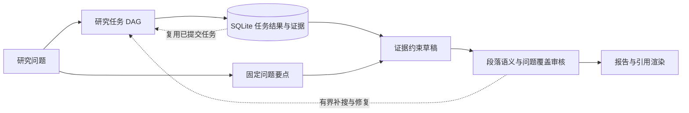

# Reliable Deep Research

[English](README.md) | 简体中文

**让研究任务可恢复，让回答覆盖问题，并在有限预算内修复证据与引用缺口。**

基于 [LangChain Open Deep Research](https://github.com/langchain-ai/open_deep_research) 的工程改进项目，使用 Python、LangGraph、asyncio、Pydantic 和 SQLite。上游提供研究编排和模型/工具集成，本项目增加持久化任务运行时与 **Evidence → 问题覆盖 → 已复核报告** 报告流水线。

**Reliable Deep Research：可恢复、证据可追溯的深度研究系统。** 主线是持久化研究任务、面向问题的报告生成和有界语义修复；早期 Claim-first 方案仅作为评测对照。方案说明见[实验评测](docs/evaluation.zh-CN.md#experiment-identifiers)。

## 解决什么问题

一次研究可能调用模型和检索工具数分钟，进程中断后已完成工作却需要重做；一份报告即使引用真实网址，来源也可能并不支持对应陈述。本项目分别处理这两类问题：

- **任务可恢复：** 有界 DAG 调度器持久化已完成任务与结果，重试失败任务，清理未完成尝试留下的过期证据。
- **围绕问题组织报告：** 在读取证据前固定问题要点，检查缺口，按存储片段审核段落，并由 Evidence ID 确定性生成引用。
- **有界反馈修复：** 保留已核实段落，根据当前审核意见修补答案与引用；最多 2 轮修复、2 个定向补搜任务，均受共享预算约束。
- **执行有边界：** 并发任务共享调用、token、任务尝试和时间预算；保留验收检查、失败状态和事件轨迹。



恢复边界是研究任务，不包含整个 LangGraph 会话恢复，也不保证外部 API 恰好执行一次。证据链回答“来自哪里”，语义支持仍依赖可能出错的模型判断。[架构与设计取舍](docs/project_overview.zh-CN.md)。

## 实验结果

30 道评测问题，每题独立运行 2 次（共 60 个评估槽位），评测共用 24 份固定参考来源。Repository Baseline（仓库基础版）与早期 Claim-first 方案保留原始尝试。

**Repository Baseline（仓库基础版）** 沿用上游 Open Deep Research 研究流程，保留仓库中的检索、模型接入和预算等实验适配。
 
| 指标 | Repository Baseline（仓库基础版） | Claim-first（早期方案） | Reliable Deep Research |
| --- | ---: | ---: | ---: |
| 验收通过 | 52/60 | 51/60 | **59/60** |
| 降级待复核 | 0 | 0 | **0** |
| 失败或超限 | 8 | 9 | **1** |
| 全部尝试要点覆盖 | 80.4% | 64.9% | **88.7%** |
| 成功报告条件覆盖 | 93.1% | 75.7% | **90.3%** |
| 抽样引用支持 | 60.9% | 96.1% | **93.6%** |
| 平均耗时（秒） | 404.9 | 667.6 | **319.3** |
| 平均模型调用 | 9.52 | 19.42 | **15.25** |

覆盖分子只统计通过报告，失败计零；引用支持来自每份报告最多 5 条陈述的抽样。参考要点由助手编写，生成和评审使用同一网关模型别名，尚无独立人工验证。表格展示本次开发后的实际交付结果；样本选择与配置变化限制了因果解释。[协议、逐点位来源与局限](docs/evaluation.zh-CN.md) · [全部 180 条评估样本](benchmarks/results/release_comparison.json)。

独立的合成故障实验中，短暂异常和超时分别恢复 30/30 次；任务提交后的真实进程退出测试中，20/20 次重启复用了已完成任务，没有重复执行该任务。未完成尝试的重启测试验证了旧 Evidence/Claim 清理。[恢复实验](docs/recovery.zh-CN.md)。


## 快速运行

安装 [uv](https://docs.astral.sh/uv/getting-started/installation/)，在仓库根目录执行。以下命令适用于 PowerShell 和 Bash：

```bash
uv sync --frozen --python 3.11 --extra dev
uv run --frozen python -m experiments.reliability.reliability_demo
uv run --frozen --extra dev python -m pytest -q
```

演示**不需要密钥**：注入一次任务失败、重试，再重放依赖任务并复用已完成的检索任务。产物位于 `artifacts/reliability_demo/`，包含 `result.json`、`events.jsonl` 和 `runtime.db`。它演示合成任务的执行语义。

实际研究报告：复制 `.env.example` 为 `.env`，填写 `OPENAI_API_KEY` 和 `TAVILY_API_KEY` 后运行：

```bash
uv run --frozen python -m experiments.runners.run_research --question "What are the failure and recovery trade-offs of durable agent workflows? Cite primary sources."
```

此命令会产生模型与检索费用。正式入口默认上限为 40 次模型调用、4 次检索、6 次任务尝试和 1,200 秒。每道题使用独立数据库；输出包含报告、验收摘要和事件轨迹。退出码非零表示本次运行未通过。[安装、自定义 API、本地检索和产物说明](docs/running.zh-CN.md)。

## 阅读代码

| 路径 | 职责 |
| --- | --- |
| [task_runtime.py](src/open_deep_research/task_runtime.py)、[runtime_store.py](src/open_deep_research/runtime_store.py) | DAG 调度、任务结果事务提交、重试与重放失效处理 |
| [coverage_reporting.py](src/open_deep_research/coverage_reporting.py)、[report_planning.py](src/open_deep_research/report_planning.py) | 问题拆解、语义审核与修复、证据 ID 引用渲染 |
| [run_budget.py](src/open_deep_research/run_budget.py)、[observability.py](src/open_deep_research/observability.py) | 共享预算与事件日志 |
| [run_research.py](experiments/runners/run_research.py) | 发布入口，复用已有研究执行与验收实现 |
| `tests/`、[benchmarks/](benchmarks/README.zh-CN.md) | 离线回归、问题与来源元数据、数值证据 |

[运行指南](docs/running.zh-CN.md) · [架构设计](docs/project_overview.zh-CN.md) · [实验评测](docs/evaluation.zh-CN.md) · [任务恢复](docs/recovery.zh-CN.md) · [发布说明](PUBLISHING.zh-CN.md)。原始语料、生成报告、数据库和缓存不随仓库发布。

