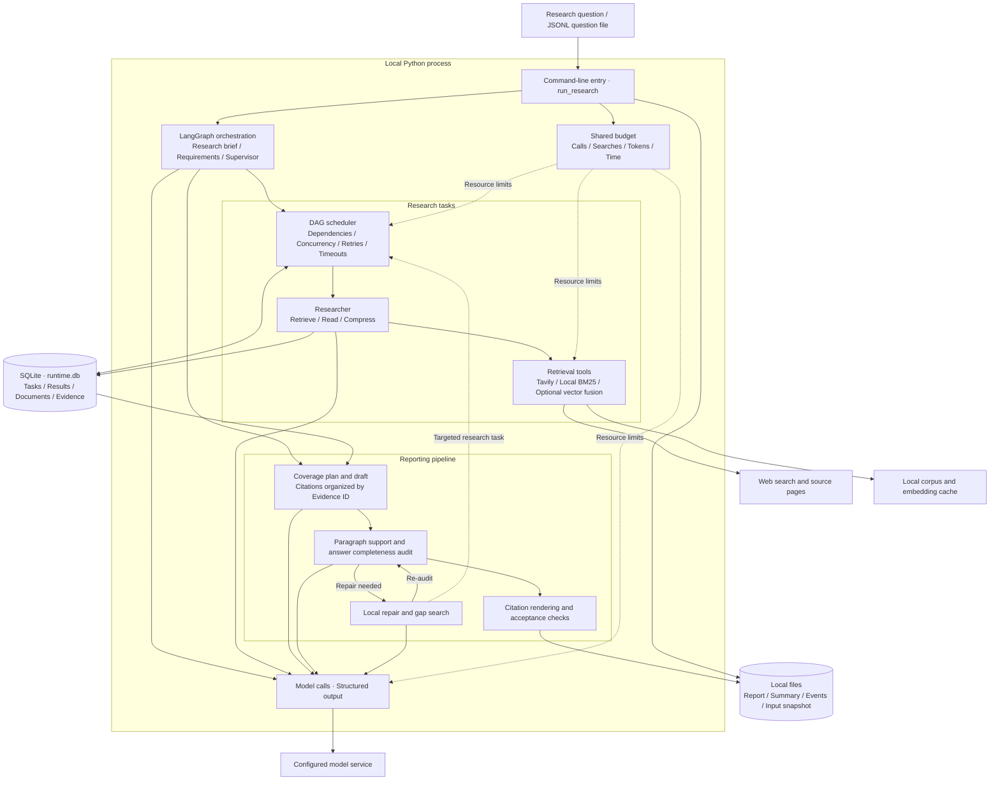

# System architecture

[简体中文](project_overview.zh-CN.md) · [README](../README.md)

Reliable Deep Research runs locally from the command line and uses LangGraph to orchestrate research tasks. Researchers retrieve and summarize sources concurrently. The reporting stage writes around question requirements, audits evidence support, and searches or repairs within budget. SQLite stores task results and evidence; reports, summaries and event logs are written to local files.

## Components and runtime relationships

Scheduling, retrieval, reporting and model calls are modules within one Python process. SQLite and files provide persistence. Retrieval uses Tavily by default or a prepared local corpus; local retrieval still uses the configured model service for research, writing and auditing.

## Module responsibilities

| Layer | Main modules | Responsibility and output |
| --- | --- | --- |
| Entry point | [run_research.py](../experiments/runners/run_research.py), [run_baseline.py](../experiments/runners/run_baseline.py) | Load questions and configuration, select the released workflow, create isolated run directories and summarize acceptance |
| Research orchestration | [deep_researcher.py](../src/open_deep_research/deep_researcher.py) | Create research briefs and question requirements, coordinate Supervisor/Researcher, and pass research results to reporting |
| Task scheduling and storage | [task_runtime.py](../src/open_deep_research/task_runtime.py), [runtime_store.py](../src/open_deep_research/runtime_store.py) | Validate DAGs, execute tasks, commit results transactionally, and handle retries, restart reuse and replay cleanup |
| Retrieval and evidence | [utils.py](../src/open_deep_research/utils.py), [local_benchmark.py](../src/open_deep_research/local_benchmark.py), [evidence.py](../src/open_deep_research/evidence.py) | Retrieve web or local sources and record source identities, passages and Evidence IDs |
| Reporting and audit | [coverage_reporting.py](../src/open_deep_research/coverage_reporting.py), [report_planning.py](../src/open_deep_research/report_planning.py) | Plan coverage, draft, audit paragraphs, repair from feedback, render citations and check provenance |
| Resources and events | [run_budget.py](../src/open_deep_research/run_budget.py), [observability.py](../src/open_deep_research/observability.py) | Reserve shared budgets, record token usage, and trace node and task events |

## Data flow for one research question

1. **Load the question.** The runner loads the question and environment configuration, then creates an independent database, event log and shared budget. The supported entry point fixes `coverage_v2`.
2. **Organize research.** LangGraph derives stable question requirements before retrieval. The Supervisor assigns work, the DAG scheduler runs ready tasks, and Researchers retrieve, read and compress sources.
3. **Store evidence.** Sources and passages are saved as Documents/Evidence. Task success and its result commit in one transaction. Derived records from unfinished attempts are invalidated before retry.
4. **Write and repair.** The report organizes evidence by question requirements, checks paragraph support and assesses completeness separately. Verified prose is preserved through at most two repair rounds and two total targeted gap tasks, followed by another audit.
5. **Write outputs.** Citations are resolved from stored evidence. The runner emits a report, acceptance summary and event trace. Unaccepted runs retain a failure or review status and return a nonzero exit code.

## State and storage

| Storage | Content | Purpose |
| --- | --- | --- |
| `<case>/runtime.db` | Task states, results, source and evidence records | Reuse committed results and invalidate stale evidence from failed or replayed attempts |
| `<case>/input.json`, `<case>/summary.json` | Question snapshot, configuration, acceptance, timing, usage and errors | Inspect the actual input and outcome |
| `<case>/report.md` | Research report or failure text | Read the deliverable |
| `<case>/events.jsonl` | Graph node, tool, task and budget events | Locate failures and resource consumption |
| `manifest.json` at run root | Summaries for every question in the batch | Index batch outcomes |

Running the same task DAG against the same database lets the scheduler reuse completed results. Explicit replay invalidates selected tasks and descendants. Each command-line invocation creates a new run rather than resuming the previous session. LangGraph checkpoints and budget counters remain in memory, so recovery operates at task level; external requests sent before a crash may still be billed.

## Report acceptance

Evidence IDs make citation provenance traceable; semantic support still depends on model judgment. Reliability and completeness are recorded separately: `incomplete_evidence` can pass reliability checks with answer gaps, while `degraded` needs review. Repair and audit share finite budgets, and unresolved gaps or failure reasons are retained.

See [Installation and usage](running.md) for setup and commands, and [Evaluation](evaluation.md) for metrics and recovery experiments.
