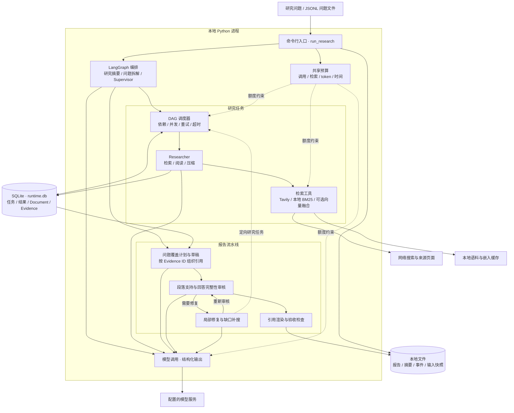

# 系统架构

[English](project_overview.md) · [中文 README](../README.zh-CN.md)

Reliable Deep Research 通过命令行在本地运行，使用 LangGraph 编排研究任务。研究阶段并发检索与整理来源，报告阶段围绕问题要点生成正文、审核证据支持，并在预算内补搜和修复。SQLite 保存任务结果与证据，报告、摘要和事件日志写入本地文件。

## 组件与运行关系

图中的调度、检索、报告和模型调用均为同一 Python 进程内的模块；SQLite 与文件用于持久化。默认检索调用 Tavily，也可改用准备好的本地语料；本地检索时，研究、写作和审核仍调用配置的模型服务。

## 模块职责

| 层次 | 主要模块 | 职责与输出 |
| --- | --- | --- |
| 运行入口 | [run_research.py](../experiments/runners/run_research.py)、[run_baseline.py](../experiments/runners/run_baseline.py) | 读取问题与配置，选择发布流程，建立独立运行目录并汇总验收结果 |
| 研究编排 | [deep_researcher.py](../src/open_deep_research/deep_researcher.py) | 生成研究摘要与问题要点，调度 Supervisor/Researcher，将研究结果交给报告阶段 |
| 任务调度与存储 | [task_runtime.py](../src/open_deep_research/task_runtime.py)、[runtime_store.py](../src/open_deep_research/runtime_store.py) | 校验 DAG、执行任务、事务提交结果，处理失败重试、重启复用与重放清理 |
| 检索与证据 | [utils.py](../src/open_deep_research/utils.py)、[local_benchmark.py](../src/open_deep_research/local_benchmark.py)、[evidence.py](../src/open_deep_research/evidence.py) | 网络或本地检索，记录来源身份、原文片段与 Evidence ID |
| 报告生成与审核 | [coverage_reporting.py](../src/open_deep_research/coverage_reporting.py)、[report_planning.py](../src/open_deep_research/report_planning.py) | 问题覆盖计划、草稿、段落审核、反馈修复、引用渲染与来源审计 |
| 资源与事件 | [run_budget.py](../src/open_deep_research/run_budget.py)、[observability.py](../src/open_deep_research/observability.py) | 共享预算预留、token 用量记录、节点与任务事件追踪 |

## 一次研究的数据流

1. **读取问题。** 命令行入口加载问题与环境配置，为每道题创建独立数据库、事件日志和共享预算。正式入口固定使用 `coverage_v2`。
2. **组织研究。** LangGraph 在检索前拆出稳定的问题要点；Supervisor 分配研究任务，DAG 调度器执行就绪任务，Researcher 检索、阅读并压缩来源。
3. **保存证据。** 来源及片段作为 Document/Evidence 写入数据库；任务成功时，将完成状态和结果放在同一事务中提交。未完成尝试的派生记录在重试前失效。
4. **生成与修复。** 报告按问题要点组织证据，逐段检查来源支持，并单独检查回答是否完整。保留已核实正文，最多进行两轮修复、总共两个定向补搜任务；修复后重新审核。
5. **输出结果。** 从存储证据解析引用，生成报告、验收摘要和事件轨迹。未通过的运行保留失败或待复核状态，并返回非零退出码。

## 状态与存储

| 存储 | 内容 | 用途 |
| --- | --- | --- |
| `<case>/runtime.db` | 任务状态、执行结果、来源与证据记录 | 复用已提交的任务结果，清理失败或重放尝试的旧证据 |
| `<case>/input.json`、`<case>/summary.json` | 问题快照、配置、验收、耗时、用量与错误 | 检查实际输入和运行结果 |
| `<case>/report.md` | 研究报告或失败文本 | 查看交付内容 |
| `<case>/events.jsonl` | 图节点、工具、任务与预算事件 | 定位失败阶段和资源消耗 |
| 运行根目录的 `manifest.json` | 本批次所有问题的摘要 | 批量运行结果索引 |

调度器用相同数据库重新执行相同任务 DAG 时，可复用已完成结果；显式重放会使选定任务及其后代失效。命令行入口每次创建新运行，不会自动恢复上次会话。LangGraph 检查点和预算计数器保存在内存中，恢复边界是研究任务；崩溃前发出的外部请求仍可能计费。

## 报告验收

Evidence ID 用于确保引用来源可追溯；来源是否支持正文仍由模型判断。可靠性与完整性分别记录：`incomplete_evidence` 可通过可靠性检查但仍有回答缺口，`degraded` 需要复核。修复与审核共享有限预算，无法完成时保留缺口或失败原因。

环境与命令见[安装与使用](running.zh-CN.md)，指标与恢复实验见[实验评测](evaluation.zh-CN.md)。
